# OpenCode Go 桥接

[](LICENSE)

让 **WorkBuddy** 客户端用上 **OpenCode Go** 订阅里的模型。

一个零依赖的本机代理，外加终端控制台和托盘图标。要补的缺口很小：客户端只给三格填，而 OpenCode Go 非要一个请求头。

> 非官方项目，与 WorkBuddy、OpenCode 两边都没有隶属关系，只是把两个公开接口接起来。
>
> **只面向 WorkBuddy 客户端。** WorkBuddy 的「自定义模型」只给接口地址、API Key、模型名称三格，没地方填请求头。OpenCode 自家的客户端和 CLI 本来就能带 `x-opencode-session`，不需要这一层，它也不是给它们写的；当通用 OpenCode 代理用会缺功能。许可证只覆盖本仓库里我写的脚本与文档，全文见 [LICENSE](LICENSE)。

## 目录

- [它解决什么](#它解决什么)
- [请求怎么走](#请求怎么走)
- [这一版多了什么](#这一版多了什么)
- [安装](#安装)
- [三步填完](#三步填完)
- [密钥在哪](#密钥在哪)
- [界面按键](#界面按键)
- [跑不起来时](#跑不起来时)
- [文件](#文件)
- [环境要求](#环境要求)
- [已知边界](#已知边界)
- [许可证](#许可证)

---

## 它解决什么

WorkBuddy 的「自定义模型」只有三个输入框：**接口地址、API Key、模型名称**，没有填 HTTP 请求头的入口。

OpenCode Go 的 `/inference/go/*` 端点强制要求请求头 `x-opencode-session`。缺了它在鉴权之前就被拒，返回 `400 MissingSessionID`。

所以中间垫一层本机代理：接住客户端的请求，补上这个头，再转发给上游。

## 请求怎么走



蓝点是请求，青点是响应。除补头之外代理还做三件事，全在本机：定会话身份（多个对话不挤到同一条上游会话）、**回填真实思考**（上游吐的 `reasoning_content` 按回答存档，下次原样还给上游——注意：**缺这个字段并不会被拒**，这一点实测过，所以存档里没有的就不再伪造占位）、留一份失败转储方便排查。

## 这一版多了什么

v4.9 从「一个 .mjs 文件加一个 .cmd」长成了一套要长期开机跑的东西，所以补了外壳：

- **托盘常驻**，关掉控制台窗口代理照跑，右键有打开控制台 / 开机自启 / 退出
- **真终端控制台**（`tui.py`），中文界面，主页看状态、配置页改配置、模型页从上游拉列表
- **一键写进客户端**：按 `W` 直接把模型写进 WorkBuddy 的模型清单（id、显示名、地址一次填好），密钥那栏留给你填
- **本项目不保存密钥**：`config.json` 里没有密钥字段，代理也不读环境变量里的密钥
- **开机自启**在界面上就能开关，不用去翻「启动」文件夹
- **单实例**：点多少次托盘都只有一个控制台窗口

v5.0 起代理**只做中转**：不签令牌、不换钥匙，客户端带来的凭据原样转发。

v5.0.1 修了四处实测出来的毛病，都会直接影响你判断"现在到底正不正常"：
- **成功被记成失败**：上游发完数据顺手关掉 keep-alive 连接时，代理也会收到一次 `aborted`，旧逻辑一律记 `ERR`。实测 79 条误报，把真故障淹掉了。现在按 `res.complete` 判：数据收全＝成功，中途断＝真截断。
- **监听器只挂不摘**：每个请求往复用的连接上再挂两个监听，而它早连好了，永远不会触发、也永远不会摘。实测同一条连接跑 40 个请求堆到 79 个，第 11 个就开始报警。现在已连上就不挂。
- **空闲连接永不回收**：客户端关掉的连接一直留在本机。现在 65 秒后回收；活动连接不受影响，长任务照跑。
- **响应头到手后没有兜底**：以前「头回来了、吐两口就停住」会永远挂着。现在连续 300 秒一个字节都没有才掐掉，日志记 `[idle]`。

还有一处改了思考内容的回填方式：只带工具调用、正文为空的那一轮，以前永远补不上真思考、只能塞占位，而且每轮重来。现在改用「工具名＋参数」识别，同一轮能认回来（实测这一类的真值命中从 0 变成有）。

**v5.0.4 把整层「补思考」的定位纠正了。** 原来假设「历史里 assistant 缺 `reasoning_content` 会被上游拒」，据此一直往里塞占位。2026-11-02 直接打上游实测，这个假设**不成立**：

| 历史里 assistant 的 `reasoning_content` | 上游回应 |
|---|---|
| 不带这个字段 | 200 |
| 空字符串 `""` | 200 |
| 短占位 `"..."` | 200 |
| 长占位（旧版塞的那句） | 200 |
| 假真值（胡编的思考） | 200 |
| 工具调用轮次（三种形态都试了） | 200 |

还用正常参数跑了一轮完整对话（`max_tokens` 300），历史 assistant 不带该字段，上游正常回了 85 字正文 + 330 字思考。

所以现在：**存档里有真思考就回填**（让上游看到真实上下文，这是收益）；**没有就不加，也不塞占位**。旧版塞进历史的占位会被逐个摘掉，日志记 `清占位=N`。控制台那一栏也从「占位」改成了「清占位」——因为它现在做的是相反的事。

v5.0.2 补上「事后能查」的底子：

- **请求体大小进日志了**。以前日志里只有耗时和状态码，厚历史会话卡死时根本没法证明"是不是发太大了"。现在每行带 `body=300KB`，`/status` 带 `bytes`，控制台的「最近请求」多了**体积**一列。
- **统计不再把半截回答算成功**。响应头一发出就是 200，之后流被截断时以前也算 ok，成功率因此虚高、失败率被压掉。现在算失败。
- **出站判定重做**（v5.0.3）。旧版只探「7890 这个门开没开」，探的其实是端口，不是能不能出网。见下面「已知边界」第一条。

## 安装

需要 **Node.js 18+**（WorkBuddy 自带的 node 也认，脚本会自己找）。
托盘、控制台、起停这三个外壳另外还要 **Python 3.8+**（只用标准库）和 **Windows**；
只要代理本体、不要外壳的话，别的系统直接 `node opencode-go-proxy.mjs` 就能跑。

```bash
git clone https://github.com/foryys/workbuddy-z-opencode-bridge.git
cd workbuddy-z-opencode-bridge
```

然后在仓库根目录跑一次，生成桌面和「启动」文件夹里的快捷方式（不需要管理员权限）：

```
python _make-shortcut.py --install
```

之后双击桌面的「OpenCode Go 启动器」。不想装快捷方式就直接双击 `service.cmd`，效果一样。

双击后同时发生两件事：右下角出现托盘图标，弹出终端窗口（标题 `OpenCode Go · 控制台`）。**关掉这个窗口代理还在跑**，窗口只是显示器，点一下托盘就能再打开。

## 三步填完

**① 按 `W`，把模型写进 WorkBuddy。**

软件会往客户端的模型清单里加一条：id、显示名、接口地址一次填好。**它只动指向本机端口的那一条**，你别的模型一字不改；写之前留一份带时间戳的备份，写完回读校验，对不上自动还原。已经配好了就一句「没动文件」，不重复写。

可以反复按，不会写坏。

**② 去 WorkBuddy 填密钥。**

左下角头像 → 设置 → 模型 → 找到刚才那条（名字像「OC · DeepSeek V4.1 Flash」）→ 「接口密钥」那栏填上你在 OpenCode Console 拿的 `sk-…`。

**本项目不保存这把密钥。** 代理只是中转：客户端每次请求都带着 `Authorization` 头过来，它原样转发。所以密钥放客户端那边就够了。

**③ 发一句话验证。**

回控制台看「最近请求」，状态 `200` 就成了。`401` 是密钥不对或头尾多了空格。

想手填而不是按 `W`：按 `Y` 复制接口地址和模型名，在客户端「添加自定义模型」里照着填，密钥同样自己填。高级选项建议勾上工具调用、图片输入、思考模式、允许关闭思考，思考强度选「中」。

模型名填**裸 id**，不要带 `opencode-go/` 前缀 —— 那个前缀是 OpenCode 客户端配置文件里的写法，直接调接口只认裸名。

> 同一个模型要装两条时（比如另订了别家、给的是同一个模型名），客户端**按 id 去重**，两条都填真名只会剩一条。`W` 会自动加 `-oc` 后缀避让，并把「这个 id → 上游真名」的映射写进配置，发上游前改回真名。

## 密钥在哪

**本项目不保存任何密钥。** 这是设计决定，不是省略：

- `config.json` 里只有四项：上游地址、默认模型、别名表、端口。**没有 `key_enc`，也没有 `local_enc`。**
- 代理**不读环境变量里的密钥、不读配置文件里的密钥**。它接住客户端请求，补一个 `x-opencode-session` 头，原样转发出去。
- 所以密钥泄不泄露，不归本项目管 —— 它手里没有可泄露的东西。
- 代理**不记录 Key**，日志只有状态码、路径、耗时、session 前 8 位。
- 代理**只监听 `127.0.0.1`**，局域网和公网都访问不到。
- 出站只有一个目标：`UPSTREAM_BASE` 指向的那一个域名。

想自己核对：打开 `config.json`，或者搜一遍代码里的 `sk-`。找不到才是对的。

`proxy.log`、`proxy-fail-*.json`、`reasoning-cache.json`、`config.json` 全在 `.gitignore` 里，不随仓库发布 —— 它们含请求原文和会话内容。

## 界面按键

**主页**：`C` 配置 · `W` 写进 WorkBuddy · `Y` 复制地址与模型名 · `A` 开关自启 · `R` 刷新 · `Q` 关窗口 · `X` 全退

**配置页**：`2` 上游地址 · `3` 默认模型 · `4` 自启 · `W` 写入 · `M` 从上游拉模型列表 · `Y` 复制 · `Esc` 返回

改任何一项都会自动保存并重启代理，不用再单独保存。**配置页没有填密钥这一项**——密钥只有一处，在客户端那条模型的设置里。

完整按键表、粘贴细节、换电脑要改什么、每种报错怎么办，都在 [说明.md](说明.md) 里。

## 跑不起来时

| 现象 | 含义 | 处理 |
|---|---|---|
| `400 MissingSessionID` | 请求没经过代理 | 接口地址是不是 `127.0.0.1:8787`，代理在不在跑 |
| `401 Invalid credential` | 到了上游，密钥不对 | 去客户端那条模型里改密钥 |
| `402 Insufficient account funds` | 地址填成了按量计费那个端点 | 换回 `127.0.0.1:8787` |
| `403 error code 1010` | Cloudflare 拦 UA，说明在直连上游 | 同上，请求没走代理 |
| 连接被拒绝 | 代理没起来 | 双击启动器；还不行看同目录 `proxy.log` 末几行 |
| 端口被占用 | 8787 被别的程序抢了 | 改 `config.json` 的 `port`，客户端地址同步改 |
| 托盘显示系统默认图标 | `icon.ico` 不在本机 | 跑一次 `python _make-icon.py`，需 Pillow |

控制台主页和配置页会指出当前处境（还没配 / 客户端那栏空着 / 在客户端里 / 旧版本令牌要换掉），照着它给的下一句做就行。

## 文件

```
opencode-go-proxy.mjs   代理主体，单文件零依赖
tui.py                  终端控制台
tray.py                 托盘（纯 ctypes 调 Shell_NotifyIcon）
ocg_config.py           公共零件：配置读写、剪贴板、代理启停（不含任何密钥逻辑）
service.cmd             应急命令行：确认在跑 / 停止 / 查状态 / 开控制台
_make-shortcut.py       生成桌面与「启动」文件夹的快捷方式
_make-icon.py           生成 icon.ico（需 Pillow）
icon.svg                图标源文件
说明.md                 完整说明：按键、排错、换电脑
docs/architecture.svg   上面那张数据流图
```

## 环境要求

- **代理本体不限系统**。`opencode-go-proxy.mjs` 是纯 Node，Linux、macOS 上直接
  `node opencode-go-proxy.mjs` 就能跑。
- **外壳限 Windows**。托盘、控制台窗口、写客户端模型清单这三样用 Windows 接口，
  别的系统上没有。
- **Node.js 18+**。18 以下用不了 `node:sqlite`，会话标题会退化为按正文猜，其余功能正常。
- **Python 3.8+**，只用标准库。没有 Python 时代理照跑，只是用不了托盘和控制台。

## 已知边界

- 只在 Windows 上测过，也只在这一个客户端上测过。
- **出站代理是"找 + 验"两步**（v5.0.3 起）。旧版只往写死的 `127.0.0.1:7890` 开个 TCP 连接，连上就当代理可用——实测两个方向都会判错：端口开着但出不去会报「经代理」（其实在裸奔），代理在别的端口会报「直连」（白扛抖动）。
  现在按 `PROXY_URL` → `HTTPS_PROXY`／`HTTP_PROXY`／`ALL_PROXY` → 常见端口（7890/7897/10809/10808/1087/1080/8889/6152/6153/8118/8080/10801）的顺序找候选，找到后发 `CONNECT` **并在隧道里真做一次 TLS 握手**才算通过——坏的代理也会立刻回 `200`，只有握手成功才证明出得去。
  结论三态：`经代理`（绿）／`直连`（黄）／`代理不通`（红，端口开着但出不去，已回退直连）。`PROXY_URL=direct` 明确直连；`PROXY_AUTODETECT=0` 关掉猜测；`PROXY_CANDIDATES` 换端口表。
  **边界**：这里验证的是"隧道能通到上游"，不是"你的钥匙有效"——后者仍由真实请求的 `401`/`402` 暴露。
- 为了让控制台里的任务名和客户端一致，会以只读方式查一次本地会话库。不写、不外传。
- 上游静默兜底默认 **300 秒**（`IDLE_TIMEOUT_MS`），按"实测成功的最长请求 252 秒"定的，没在真实长思考上长跑过；觉得掐早了就调大，填 `0` 关掉。
- 客户端空闲连接 **65 秒**回收（`KEEPALIVE_TIMEOUT_MS`），填 `0` 恢复"永不回收"。

## 许可证

**PolyForm Noncommercial License 1.0.0**。全文见 [LICENSE](LICENSE)。

只授权非商业用途：个人出于研究、实验、学习、兴趣的使用，以及慈善组织、教育机构、公共研究机构、公共安全与卫生机构、环保组织、政府机构的使用。公司业务中的任何使用、转售、随商业产品或服务分发，都不在授权范围内，需要另行取得许可。

Copyright (c) 2026 foryys。
