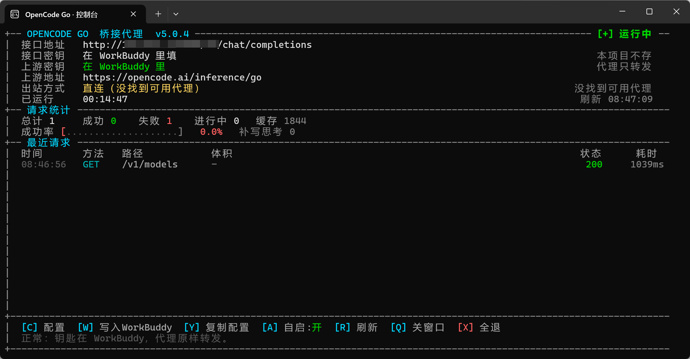

# OpenCode Go 桥接

[](LICENSE)

让 **WorkBuddy** 客户端用上 **OpenCode Go** 订阅里的模型。

一个零依赖的本机代理，外加终端控制台和托盘图标。要补的缺口很小：客户端只给三格填，而 OpenCode Go 非要一个请求头。

> 非官方项目，与 WorkBuddy、OpenCode 两边都没有隶属关系，只是把两个公开接口接起来。
>
> **只面向 WorkBuddy 客户端。** WorkBuddy 的「自定义模型」只给接口地址、API Key、模型名称三格，没地方填请求头。OpenCode 自家的客户端和 CLI 本来就能带 `x-opencode-session`，不需要这一层，它也不是给它们写的；当通用 OpenCode 代理用会缺功能。许可证只覆盖本仓库里我写的脚本与文档，全文见 [LICENSE](LICENSE)。

## 目录

- [一、解决什么](#一解决什么)
- [二、请求链路](#二请求链路)
- [三、主要特点](#三主要特点)
- [四、安装上手](#四安装上手)
- [五、配置三步](#五配置三步)
- [六、密钥在哪](#六密钥在哪)
- [七、界面按键](#七界面按键)
- [八、故障排查](#八故障排查)
- [九、文件清单](#九文件清单)
- [十、环境要求](#十环境要求)
- [十一、已知边界](#十一已知边界)
- [十二、授权许可](#十二授权许可)

---

## 一、解决什么

WorkBuddy 的「自定义模型」只有三个输入框：**接口地址、API Key、模型名称**，没有填 HTTP 请求头的入口。

OpenCode Go 的 `/inference/go/*` 端点强制要求请求头 `x-opencode-session`。缺了它在鉴权之前就被拒，返回 `400 MissingSessionID`。

所以中间垫一层本机代理：接住客户端的请求，补上这个头，再转发给上游。

## 二、请求链路


蓝点是请求，青点是响应。除补头之外，代理还在本机做三件事：定会话身份（多个对话不挤到同一条上游会话）、回填真实思考（上游吐过 `reasoning_content` 就按回答存档、下次原样还回去）、按需留一份失败转储方便排查。

装上之后，终端控制台长这样——状态、出站方式、请求统计和每一次请求的体积都在一屏里：



## 三、主要特点

- **不保存任何密钥。** `config.json` 里没有密钥字段，代理也不读环境变量或配置文件里的密钥。客户端每次请求带着 `Authorization` 过来，它原样转发——手里没有可泄露的东西。
- **一键写进客户端。** 按 `W` 把模型 id、显示名、接口地址一次填好，**只动指向本机端口的那一条**，你别的模型一字不改；写前留备份，写完回读校验，对不上自动还原，已配好就不写盘。
- **同一模型装两条也不打架。** 客户端按 id 去重，`W` 会自动加 `-oc` 后缀避让，并把「这个 id → 上游真名」的映射记进配置，发上游前改回真名。
- **出站选路会验，不只是看端口。** 先按 `PROXY_URL` → `HTTP(S)_PROXY`/`ALL_PROXY` → 常见端口找候选，再发 `CONNECT` 并在隧道里真做一次 TLS 握手才算通过。结论分三态：经代理 / 直连 / 代理不通，最后一种是红的，因为它才是要动手的那种。
- **不伪造思考内容。** 上游吐过真思考才回填，没吐就留空——实测上游并不校验这个字段，塞假占位只会让它看到假上下文。
- **事后查得动。** 日志每行带请求体大小和出站方式；`/diag` 一次给出刚测的出站状态、当前在用的那条、最近失败和在飞任务。
- **托盘常驻，单实例。** 关掉控制台窗口代理照跑，窗口只是显示器；点多少次托盘都只有一个窗口。

## 四、安装上手

需要 **Node.js 18+**（WorkBuddy 自带的 node 也认，脚本会自己找）。
托盘、控制台、起停这三个外壳另外还要 **Python 3.8+**（只用标准库）和 **Windows**；
只要代理本体、不要外壳的话，别的系统直接 `node opencode-go-proxy.mjs` 就能跑。

```bash
git clone https://github.com/foryys/workbuddy-z-opencode-bridge.git
cd workbuddy-z-opencode-bridge
```

然后在仓库根目录跑一次，生成桌面和「启动」文件夹里的快捷方式（不需要管理员权限）：

```
python _make-shortcut.py --install
```

之后双击桌面的「OpenCode Go 启动器」。不想装快捷方式就直接双击 `service.cmd`，效果一样。

双击后同时发生两件事：右下角出现托盘图标，弹出终端窗口（标题 `OpenCode Go · 控制台`）。**关掉这个窗口代理还在跑**，窗口只是显示器，点一下托盘就能再打开。

## 五、配置三步

**① 按 `W`，把模型写进 WorkBuddy。**

软件会往客户端的模型清单里加一条：id、显示名、接口地址一次填好。可以反复按，不会写坏。

**② 去 WorkBuddy 填密钥。**

左下角头像 → 设置 → 模型 → 找到刚才那条（名字像「OC · DeepSeek V4.1 Flash」）→ 「接口密钥」那栏填上你在 OpenCode Console 拿的 `sk-…`。

**本项目不保存这把密钥。** 代理只是中转：客户端每次请求都带着 `Authorization` 头过来，它原样转发。

**③ 发一句话验证。**

回控制台看「最近请求」，状态 `200` 就成了。`401` 是密钥不对或头尾多了空格。

想手填而不是按 `W`：按 `Y` 复制接口地址和模型名，在客户端「添加自定义模型」里照着填，密钥同样自己填。高级选项建议勾上工具调用、图片输入、思考模式、允许关闭思考，思考强度选「中」。

模型名填**裸 id**，不要带 `opencode-go/` 前缀 —— 那个前缀是 OpenCode 客户端配置文件里的写法，直接调接口只认裸名。

## 六、密钥在哪

**本项目不保存任何密钥。** 这是设计决定，不是省略：

- `config.json` 里只有四项：上游地址、默认模型、别名表、端口。
- 代理**不读环境变量里的密钥、不读配置文件里的密钥**。它接住客户端请求，补一个 `x-opencode-session` 头，原样转发出去。
- 代理**不记录 Key**，日志只有状态码、路径、耗时、请求体大小和 session 前 8 位。
- 代理**只监听 `127.0.0.1`**，局域网和公网都访问不到。
- 出站只连两处：上游域名，以及你本机的代理端口（如果启用了代理）。

想自己核对：打开 `config.json`，或者搜一遍代码里的 `sk-`。找不到才是对的。

`proxy.log`、`proxy-fail-*.json`、`reasoning-cache.json`、`config.json` 全在 `.gitignore` 里，不随仓库发布 —— 它们含请求原文和会话内容。

## 七、界面按键

**主页**：`C` 配置 · `W` 写进 WorkBuddy · `Y` 复制地址与模型名 · `A` 开关自启 · `R` 刷新 · `Q` 关窗口 · `X` 全退

**配置页**：`2` 上游地址 · `3` 默认模型 · `4` 自启 · `W` 写入 · `M` 从上游拉模型列表 · `Y` 复制 · `Esc` 返回

改任何一项都会自动保存并重启代理，不用再单独保存。**配置页没有填密钥这一项**——密钥只有一处，在客户端那条模型的设置里。

完整按键表、粘贴细节、换电脑要改什么、每种报错怎么办，都在 [说明.md](说明.md) 里。

## 八、故障排查

| 现象 | 含义 | 处理 |
|---|---|---|
| `400 MissingSessionID` | 请求没经过代理 | 接口地址是不是 `127.0.0.1:8787`，代理在不在跑 |
| `401 Invalid credential` | 到了上游，密钥不对 | 去客户端那条模型里改密钥 |
| `402 Insufficient account funds` | 地址填成了按量计费那个端点 | 换回 `127.0.0.1:8787` |
| `403 error code 1010` | Cloudflare 拦 UA，说明在直连上游 | 同上，请求没走代理 |
| 连接被拒绝 | 代理没起来 | 双击启动器；还不行看同目录 `proxy.log` 末几行 |
| 端口被占用 | 8787 被别的程序抢了 | 改 `config.json` 的 `port`，客户端地址同步改 |
| 托盘显示系统默认图标 | `icon.ico` 不在本机 | 跑一次 `python _make-icon.py`，需 Pillow |
| 突然连接不上 | 代理掉了，或出站不通 | 打开 `http://127.0.0.1:8787/diag` 看当时状态 |

控制台主页和配置页会指出当前处境（还没配 / 客户端那栏空着 / 在客户端里 / 旧版本令牌要换掉），照着它给的下一句做就行。

## 九、文件清单

```
opencode-go-proxy.mjs   代理主体，单文件零依赖
tui.py                  终端控制台
tray.py                 托盘（纯 ctypes 调 Shell_NotifyIcon）
ocg_config.py           公共零件：配置读写、剪贴板、代理启停（不含任何密钥逻辑）
service.cmd             应急命令行：确认在跑 / 停止 / 查状态 / 开控制台
_make-shortcut.py       生成桌面与「启动」文件夹的快捷方式
_make-icon.py           生成 icon.ico（需 Pillow）
icon.svg                图标源文件
说明.md                 完整说明：按键、排错、换电脑
docs/architecture.svg   数据流图
docs/console.png        终端控制台截图
```

## 十、环境要求

- **代理本体不限系统**。`opencode-go-proxy.mjs` 是纯 Node，Linux、macOS 上直接
  `node opencode-go-proxy.mjs` 就能跑。
- **外壳限 Windows**。托盘、控制台窗口、写客户端模型清单这三样用 Windows 接口，
  别的系统上没有。
- **Node.js 18+**。18 以下用不了 `node:sqlite`，会话标题会退化为按正文猜，其余功能正常。
- **Python 3.8+**，只用标准库。没有 Python 时代理照跑，只是用不了托盘和控制台。

## 十一、已知边界

- 只在 Windows 上测过，也只在这一个客户端上测过。
- **出站判定验的是「隧道能通到上游」，不是「你的钥匙有效」。** 后者要发业务请求才知道，代价太大不能每分钟做；钥匙对不对仍由真实请求的 `401`/`402` 暴露。可用 `PROXY_URL=direct` 明确直连，`PROXY_AUTODETECT=0` 关掉自动发现，`PROXY_CANDIDATES` 换端口表。
- 为了让控制台里的任务名和客户端一致，会以只读方式查一次本地会话库。不写、不外传。
- 上游静默兜底默认 **300 秒**（`IDLE_TIMEOUT_MS`，填 `0` 关掉）；客户端空闲连接 **65 秒**回收（`KEEPALIVE_TIMEOUT_MS`，填 `0` 恢复不回收）。

## 十二、授权许可

**PolyForm Noncommercial License 1.0.0**。全文见 [LICENSE](LICENSE)。

只授权非商业用途：个人出于研究、实验、学习、兴趣的使用，以及慈善组织、教育机构、公共研究机构、公共安全与卫生机构、环保组织、政府机构的使用。公司业务中的任何使用、转售、随商业产品或服务分发，都不在授权范围内，需要另行取得许可。

Copyright (c) 2026 foryys。
