# OpenCode Go 桥接

[](LICENSE)

让 **WorkBuddy** 客户端用上 **OpenCode Go** 订阅里的模型。

一个零依赖的本机代理，外加终端控制台和托盘图标。要补的缺口很小：客户端只给三格填，而 OpenCode Go 非要一个请求头。

> 非官方项目，与 WorkBuddy、OpenCode 两边都没有隶属关系，只是把两个公开接口接起来。
>
> **只面向 WorkBuddy 客户端。** WorkBuddy 的「自定义模型」只给接口地址、API Key、模型名称三格，没地方填请求头。OpenCode 自家的客户端和 CLI 本来就能带 `x-opencode-session`，不需要这一层，它也不是给它们写的；当通用 OpenCode 代理用会缺功能。许可证只覆盖本仓库里我写的脚本与文档，全文见 [LICENSE](LICENSE)。

## 目录

- [它解决什么](#它解决什么)
- [请求怎么走](#请求怎么走)
- [这一版多了什么](#这一版多了什么)
- [安装](#安装)
- [三步填完](#三步填完)
- [两把钥匙别弄混](#两把钥匙别弄混)
- [界面按键](#界面按键)
- [钥匙存在哪](#钥匙存在哪)
- [跑不起来时](#跑不起来时)
- [文件](#文件)
- [环境要求](#环境要求)
- [已知边界](#已知边界)
- [许可证](#许可证)

---

## 它解决什么

WorkBuddy 的「自定义模型」只有三个输入框：**接口地址、API Key、模型名称**，没有填 HTTP 请求头的入口。

OpenCode Go 的 `/inference/go/*` 端点强制要求请求头 `x-opencode-session`。缺了它在鉴权之前就被拒，返回 `400 MissingSessionID`。

所以中间垫一层本机代理：接住客户端的请求，补上这个头，再转发给上游。

## 请求怎么走



蓝点是请求，青点是响应。除补头之外代理还做三件事，全在本机：定会话身份（多个对话不挤到同一条上游会话）、补思考字段（DeepSeek 思考模式缺 `reasoning_content` 会整条被拒）、留一份失败转储方便排查。

## 这一版多了什么

v4.9 从「一个 .mjs 文件加一个 .cmd」长成了一套要长期开机跑的东西，所以补了外壳：

- **托盘常驻**，关掉控制台窗口代理照跑，右键有打开控制台 / 开机自启 / 退出
- **真终端控制台**（`tui.py`），中文界面，主页看状态、配置页改配置、模型页从上游拉列表
- **页面内完成配置**：填一次上游密钥，软件把「接口地址 + 接口密钥 + 模型名」整理好，按 `Y` 复制，粘进客户端
- **两把钥匙都加密**：Windows DPAPI，绑当前账号 + 这台机器，`config.json` 里没有明文
- **开机自启**在界面上就能开关，不用去翻「启动」文件夹
- **单实例**：点多少次托盘都只有一个控制台窗口

代理主体（`opencode-go-proxy.mjs`）的逻辑没变，改的是外面这层壳。

## 安装

需要 **Node.js 18+**（WorkBuddy 自带的 node 也认，脚本会自己找）。
托盘、控制台、起停这三个外壳另外还要 **Python 3.8+**（只用标准库）和 **Windows**；
只要代理本体、不要外壳的话，别的系统直接 `node opencode-go-proxy.mjs` 就能跑。

```bash
git clone https://github.com/foryys/workbuddy-z-opencode-bridge.git
cd workbuddy-z-opencode-bridge
```

然后在仓库根目录跑一次，生成桌面和「启动」文件夹里的快捷方式（不需要管理员权限）：

```
python _make-shortcut.py --install
```

之后双击桌面的「OpenCode Go 启动器」。不想装快捷方式就直接双击 `service.cmd`，效果一样。

双击后同时发生两件事：右下角出现托盘图标，弹出终端窗口（标题 `OpenCode Go · 控制台`）。**关掉这个窗口代理还在跑**，窗口只是显示器，点一下托盘就能再打开。

## 三步填完

**① 按 `C` 进配置页，按 `1` 填上游密钥。**

把 OpenCode Console 拿到的那把粘进去，回车。它会加密存进 `config.json`，代理自动重启加载（断一两秒）。粘贴时屏幕只显示一排星号和「已输入 N 个字符」，不会亮出真钥匙。

**② 按 `Y` 复制配置。**

剪贴板里就是这三行：

```
OpenCode Go · 填进 WorkBuddy 的自定义模型
接口地址  http://127.0.0.1:8787/v1/chat/completions
接口密钥  sk-ocg-（软件生成的那把）
模型名称  deepseek-v4.1-flash
```

还没填上游密钥就按 `Y`，它不会给你一份看着能用其实 401 的配置，而是直接把光标带到填密钥那一栏。

**③ 粘进客户端。**

左下角头像 → 设置 → 模型 → 自定义模型 → 添加模型，提供商选「自定义」，三段照抄。高级选项建议勾上工具调用、图片输入、思考模式、允许关闭思考，思考强度选「中」。

模型名填**裸 id**，不要带 `opencode-go/` 前缀 —— 那个前缀是 OpenCode 客户端配置文件里的写法，直接调接口只认裸名。

## 两把钥匙别弄混

| 叫法 | 谁给的 | 谁用 | 长什么样 |
|---|---|---|---|
| **上游密钥** | 你去 OpenCode Console 拿的 | 只有代理用，不填给客户端 | `sk-…` |
| **接口密钥** | 软件生成的 | 你粘进客户端 | `sk-ocg-…` |

软件只跟你要第一把。第二把由软件发，照抄就行。客户端里填的是令牌，代理收到才换成真钥匙转发 —— 真钥匙因此永远不进客户端的配置文件。

## 界面按键

**主页**：`C` 配置 · `Y` 复制配置 · `A` 开关自启 · `R` 刷新 · `Q` 关窗口 · `X` 全退

**配置页**：`1` 上游密钥 · `2` 上游地址 · `3` 默认模型 · `4` 自启 · `5` 换一把接口密钥 · `M` 从上游拉模型列表 · `Y` 复制 · `Esc` 返回

改任何一项都会自动保存并重启代理，不用再单独保存。粘贴不用管格式：整行 `Authorization: Bearer sk-xxx`、`export KEY=sk-xxx`、带引号反引号、甚至复制了两遍，都会自动收拾成一把干净的钥匙。

完整按键表、粘贴细节、换电脑要改什么、每种报错怎么办，都在 [说明.md](说明.md) 里。

## 钥匙存在哪

- `config.json` 里只有两个字段 `key_enc` 和 `local_enc`，都是 `CryptProtectData` 加密后的密文。这把锁绑当前账号和这台机器，文件拷到别人电脑或别的账号下都解不开，**文件里连一个明文 `sk-` 都找不到**。
- 明文只活在两个地方：控制台进程的内存，和代理进程的环境变量。都不落盘。
- 代理**不记录 Key**，日志只有状态码、路径、耗时、session 前 8 位。
- 代理**只监听 `127.0.0.1`**，局域网和公网都访问不到。
- 出站只有一个目标：`UPSTREAM_BASE` 指向的那一个域名。

`proxy.log`、`proxy-fail-*.json`、`reasoning-cache.json`、`config.json` 全在 `.gitignore` 里，不随仓库发布 —— 它们含请求原文和会话内容。

## 跑不起来时

| 现象 | 含义 | 处理 |
|---|---|---|
| `400 MissingSessionID` | 请求没经过代理 | 接口地址是不是 `127.0.0.1:8787`，代理在不在跑 |
| `401 Invalid credential` | 到了上游，钥匙不对 | 配置页按 `1` 重填；回车自动生效 |
| `402 Insufficient account funds` | 地址填成了按量计费那个端点 | 换回 `127.0.0.1:8787` |
| `403 error code 1010` | Cloudflare 拦 UA，说明在直连上游 | 同上，请求没走代理 |
| 连接被拒绝 | 代理没起来 | 双击启动器；还不行看同目录 `proxy.log` 末几行 |
| 端口被占用 | 8787 被别的程序抢了 | 改 `config.json` 的 `port`，客户端地址同步改 |
| 托盘显示系统默认图标 | 仓库里没带 `icon.ico` | 跑一次 `python _make-icon.py`，需 Pillow |

控制台主页那行「上游密钥」会指出当前处境（还没填 / 已在 WorkBuddy 中填写 / 已在本机加密保存 / 旧密文解不开），照着它给的下一句做就行。

## 文件

```
opencode-go-proxy.mjs   代理主体，单文件零依赖
tui.py                  终端控制台
tray.py                 托盘（纯 ctypes 调 Shell_NotifyIcon）
ocg_config.py           公共零件：配置读写、密钥加密、剪贴板、代理启停
service.cmd             应急命令行：确认在跑 / 停止 / 查状态 / 开控制台
_make-shortcut.py       生成桌面与「启动」文件夹的快捷方式
_make-icon.py           生成 icon.ico（需 Pillow）
icon.svg                图标源文件
说明.md                 完整说明：按键、排错、换电脑
docs/architecture.svg   上面那张数据流图
```

## 环境要求

- **代理本体不限系统**。`opencode-go-proxy.mjs` 是纯 Node，Linux、macOS 上直接
  `node opencode-go-proxy.mjs` 就能跑。
- **外壳限 Windows**。托盘、控制台窗口、DPAPI 加密钥匙这三样用 Windows 接口，
  别的系统上没有。
- **Node.js 18+**。18 以下用不了 `node:sqlite`，会话标题会退化为按正文猜，其余功能正常。
- **Python 3.8+**，只用标准库。没有 Python 时代理照跑，但解不开加密的钥匙，只能透传客户端自带的钥匙。

## 已知边界

- 只在 Windows 上测过，也只在这一个客户端上测过。
- 出站默认探测 `127.0.0.1:7890` 这个本地代理端口，通了就走隧道，不通直连。本机没有代理不影响使用。要改就设 `PROXY_URL`，或填 `direct` 强制直连。
- 为了让控制台里的任务名和客户端一致，会以只读方式查一次本地会话库。不写、不外传。

## 许可证

**PolyForm Noncommercial License 1.0.0**。全文见 [LICENSE](LICENSE)。

只授权非商业用途：个人出于研究、实验、学习、兴趣的使用，以及慈善组织、教育机构、公共研究机构、公共安全与卫生机构、环保组织、政府机构的使用。公司业务中的任何使用、转售、随商业产品或服务分发，都不在授权范围内，需要另行取得许可。

Copyright (c) 2026 foryys。
